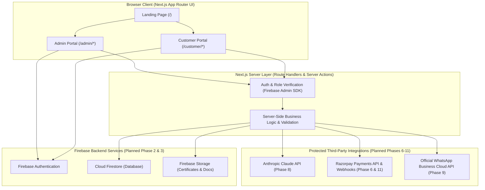

# System Architecture — Agriculture Product Manufacturing Company Digital Platform

> **Implementation Status Note**: In **Phase 1**, the frontend Next.js App Router foundation, TypeScript strict configuration, reusable UI design system, and initial routes (`/`, `/customer/login`, `/admin/login`) are implemented. All Firebase, Claude AI, Razorpay, and WhatsApp Business components described below represent the **planned architecture** for Phases 2 through 12.

---

## 1. High-Level Architecture Overview

---

## 2. Frontend Architecture (Implemented in Phase 1)

- **Framework**: Next.js (App Router) with React 19 and strict TypeScript.
- **Styling & Design System**: Tailwind CSS v4 combined with CSS custom property design tokens in `src/app/globals.css`.
- **Component Organization**:
  - `src/components/ui/`: Low-level, accessible primitives (`Button`, `Input`, `FormField`, `Card`, `Container`, `StatusNotice`).
  - `src/components/layout/`: Consistent page chrome (`Header`, `Footer`).
  - `src/components/shared/`: Domain-shared components such as `PortalLoginForm`.
- **Configuration & Placeholders**: Centralized in `src/config/site.ts` so placeholder strings can be replaced cleanly with verified company data or dynamic database queries without refactoring UI layouts.

---

## 3. Planned Firebase Data Layer (Phase 2 & Phase 3)

### 3.1 Firebase Authentication (Phase 2)
- Handles user credential verification (email/password) for both customers and administrators.
- Client-side Firebase Auth SDK acquires ID tokens, which are exchanged/verified on the server using the **Firebase Admin SDK**.

### 3.2 Cloud Firestore (Phase 3)
Planned core collections:
- `users`: User profiles, role metadata (`customer` | `admin`), account status.
- `products`: Verified product catalogue items, active compositions, pack sizes, usage instructions, and regulatory metadata.
- `batches`: Manufacturing batch records, lab quality results, manufacturing/expiry dates.
- `orders`: Customer order headers, line items, payment status, allocated batches, and fulfilment tracking.
- `certificates`: Batch validation certificate records linked to `batches` and `orders`.

### 3.3 Firebase Storage (Phase 3 & Phase 6)
- Stores official product PDF leaflets, safety data sheets (SDS), and generated batch validation certificate files with strict access control rules.

---

## 4. Server-Side Business Logic & Role-Based Authorization (Phase 2 & Phase 3)

- **Zero Trust on Client UI**: Hiding a button or route in the browser is never treated as security.
- **Server-Side Token & Role Verification**:
  - Every protected API route, Server Action, and protected server page will verify the Firebase ID token or session cookie using the **Firebase Admin SDK**.
  - Administrative operations (creating products, issuing validation certificates, modifying order statuses) will require an explicit verified `admin` custom claim or server-verified admin role record.
- **Strict Validation**: All incoming payloads to server routes will be validated on the server before touching Cloud Firestore or external APIs.

---

## 5. Planned Third-Party Integrations & Security Boundaries

| Integration | Planned Phase | Execution Context | Security & Architectural Design |
| :--- | :--- | :--- | :--- |
| **Firebase Admin SDK** | Phase 2 & 3 | **Server-Only** | Uses service account credentials via `FIREBASE_ADMIN_*` environment variables. Never imported in client components. |
| **Razorpay Payments** | Phase 6 & 11 | **Server + Client Checkout** | Order creation and HMAC-SHA256 payment signature verification (`RAZORPAY_KEY_SECRET`, `RAZORPAY_WEBHOOK_SECRET`) execute strictly on the server. |
| **Anthropic Claude API** | Phase 8 | **Server-Only** | `ANTHROPIC_API_KEY` stays strictly on the server. System prompts and retrieval context restrict responses to verified company product data. |
| **WhatsApp Business API** | Phase 9 | **Server-Only** | Triggered by server-side order and certificate events using `WHATSAPP_ACCESS_TOKEN`. |
